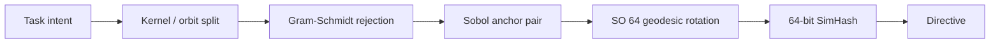

# KADRAN-H

Local MCP server that steers LLM output out of its statistical average. It protects the task's functional kernel, rejects the domain's stock patterns, and rotates the stylistic orbit toward a cross-domain anchor. The model gets one compact directive instead of another brainstorming loop.

[](https://github.com/Syron01/kadran-h/actions/workflows/ci.yml)
[](https://github.com/Syron01/kadran-h/blob/main/LICENSE)

```text
[HQMS α=0.90 | KEEP:high trust,clear CTA,readable | BAN:Purple Blue Gradient,Glassmorphism Cards,3D Hero Blob | ANCHOR:Transit Wayfinding × Border Crossing File | HASH:e368816e5733c3ab]
```

That directive is real output from `npm run samples`. It is 22 tokens. The server makes no network calls, calls no LLM, and does not store prompts or completions. Its local store keeps hashes, anchor labels, and coarse telemetry.

## Quickstart

Node.js 20 or newer.

```bash
git clone https://github.com/Syron01/kadran-h.git
cd kadran-h
npm ci
npm run build
```

Point your MCP client at the built server:

```json
{
  "mcpServers": {
    "kadran-h": {
      "command": "node",
      "args": ["/absolute/path/to/kadran-h/dist/mcp/server.js"]
    }
  }
}
```

| Client | Config file |
| :--- | :--- |
| Claude Desktop | `claude_desktop_config.json` in the Claude Desktop settings directory |
| Claude Code | project `.mcp.json` or user-level `~/.claude.json` |
| Cursor | `.cursor/mcp.json` or `~/.cursor/mcp.json` |
| Gemini CLI | `~/.gemini/settings.json` |

Install the skill so the agent knows when to call the server:

| Client | Skill path |
| :--- | :--- |
| Claude Code | `.claude/skills/kadran-h/SKILL.md` |
| Cursor | `.cursor/skills/kadran-h/SKILL.md` |
| Gemini CLI | `.gemini/skills/kadran-h/SKILL.md` |

```bash
mkdir -p .claude/skills/kadran-h
cp skills/kadran-h/SKILL.md .claude/skills/kadran-h/SKILL.md
```

> [!TIP]
> Use `alpha=0.9` when the user asks for something original. Keep `alpha=0.5` for adjacent exploration, and `0.0` when the existing direction is already right.

## Tools

| Tool | Input | Returns |
| :--- | :--- | :--- |
| `steer_intent` | `domain`, `kernel_constraints`, `alpha?`, `exclude_tags?` | One directive, hard-capped at 35 tokens |
| `commit_output` | `hash_id`, `used_patterns` | Local anti-repeat acknowledgement |
| `diversity_telemetry` | none | Same/near/far counts and a normalized entropy score |

The directive has one job: tell the model what must survive, what must not appear, and which cross-domain lens to use.

| Field | Meaning |
| :--- | :--- |
| `KEEP` | Invariant functional constraints. They must survive the steering. |
| `BAN` | Stock patterns the result must avoid. |
| `ANCHOR` | Primary concept plus a secondary concept from another domain. |
| `HASH` | 64-bit SimHash used by `commit_output` and the novelty check. |

## Why not raise temperature?

Temperature changes how randomly the model samples. It has no idea which directions are the domain's clichés, so a high value produces more variance and more broken structure: code that stops compiling, music that loses its pulse, layouts that stop reading.

KADRAN-H removes named stock patterns from a fixed concept space and keeps the task's kernel fixed. The model still writes the answer; it starts from a different lens instead of a noisier one.

## How it works



<details>
<summary>Math and implementation notes</summary>

1. The intent is split into a protected kernel and a stylistic orbit: `v = v_K + v_perp`.
2. Active clichés and committed patterns are orthonormalized with modified Gram-Schmidt. The orbit is projected out of their span: `v_perp = v - Σ <v, c_i> c_i`.
3. A primary anchor comes from the selected domain. A secondary anchor comes from another domain. The pair is chosen with a Sobol-ranked permutation, so repeated calls walk the lattice instead of clustering on random picks.
4. The orbit is rotated by `theta = alpha * PI / 2` toward the anchor while the kernel is copied through unchanged. The orbit norm is conserved:
   `v_star = v_K + ||v_perp|| * (cos(theta) * u_orbit + sin(theta) * u_anchor)`.
5. A 64-bit SimHash (`sign(Rx)`) fingerprints the result. Novelty is Hamming distance, computed with XOR and popcount. History never leaves the machine.
6. If an anchor collapses into the banned subspace, a deterministic Halton point in R^64 is used as the escape vector.

The concept vectors are deterministic hashed bag-of-words projections, not a neural encoder. See [Limitations](#limitations).

</details>

<details>
<summary>Generated samples for all five domains</summary>

```text
coding_architecture: [HQMS α=0.95 | KEEP:O(1) rate limiter,thread-safe | BAN:Redis Cache,Token Bucket,LRU Map | ANCHOR:Immune Memory × Korean Pansori | HASH:fef5b72738b98dfd]
music_composition: [HQMS α=0.90 | KEEP:80 BPM,warm bass,uninterrupted flow | BAN:Four Chord Pop,Lo-Fi Rain Beat,4/4 Jazz Piano | ANCHOR:Carnatic Ragam × Ottoman Calligraphy | HASH:0140aae1abc53362]
visual_design: [HQMS α=0.90 | KEEP:high trust,clear CTA,readable | BAN:Purple Blue Gradient,Glassmorphism Cards,3D Hero Blob | ANCHOR:Transit Wayfinding × Border Crossing File | HASH:e368816e5733c3ab]
creative_writing: [HQMS α=0.85 | KEEP:first person,unreliable memory,short sentences | BAN:Hero's Journey,Chosen One,Dystopian YA | ANCHOR:Oral Epic Formula × Akerman Domestic | HASH:f2001946581181c0]
cultural_discovery: [HQMS α=0.90 | KEEP:deep loneliness,inner observation | BAN:The Prestige,Her,Blade Runner 2049 | ANCHOR:Calvino Cosmicomics × Kolmogorov Compression | HASH:04ecac48c5f68a02]
```

</details>

## Domains

Each pack has 36 anchors and 16 mode ideals. The 180 anchors span computer science, physics, architecture, music theory, philosophy, biology, and literature. A primary anchor from the chosen domain is paired with a secondary anchor from another domain, giving 5,184 ordered cross-domain pairs per domain.

| Domain | Example banned average | Example anchors |
| :--- | :--- | :--- |
| `coding_architecture` | Redis Cache, Token Bucket | Immune Memory, CRDT Semilattice |
| `music_composition` | Four Chord Pop, Lo-Fi Rain Beat | Gamelan Polyrhythm, Carnatic Ragam |
| `visual_design` | Purple Blue Gradient, Glassmorphism Cards | Risograph Overprint, Transit Wayfinding |
| `creative_writing` | Hero's Journey, Dystopian YA | Oulipo Lipogram, Oral Epic Formula |
| `cultural_discovery` | The Prestige, Blade Runner 2049 | Akerman Domestic, Slow Cinema |

`src/lattice/domains.json` is the contribution surface. Adding anchors or mode ideals requires no code: keep labels short, add the concept to the relevant array, and run `npm test`.

## Privacy and state

The server speaks stdio and makes no outbound requests. It does not store prompts, source code, or generated text. `~/.kadran-h/history.json` holds 64-bit hashes, anchor labels, domain keys, same/near/far counters, and the pattern tags passed to `commit_output`. Set `KADRAN_H_HOME` to relocate it. Deleting the file resets the anti-repeat memory.

## Performance

Measured on Node v24.19.0, Windows 11, Intel i7-14650HX. Reproduce with `npm run bench`.

| Workload | Calls | p50 | p95 | Max | Tokens |
| :--- | ---: | ---: | ---: | ---: | ---: |
| In-memory steering | 1,000 | 0.592 ms | 0.903 ms | 1.329 ms | 18–22 |
| File-backed steering | 200 | 1.279 ms | 1.689 ms | 1.970 ms | 18–21 |

The file-backed row includes the atomic write to `~/.kadran-h/history.json`. The hard token cap is 35; the benchmark workload stays below it. No remote API, no model call, no neural embedding model.

## Verification

`npm test` runs 12 tests: quotient rejection, kernel and orbit-norm preservation, Sobol permutations, SimHash determinism, 30 unique anchors and hashes in under 100 ms, 35-token caps across every domain, persistent telemetry, and aliases.

```text
$ npm test
Test Files  1 passed (1)
Tests       12 passed (12)
```

CI runs typecheck, tests, build, and a real stdio MCP handshake (`npm run smoke`) on Node 20, 22, and 24.

## Limitations

- Hashed bag-of-words vectors are deterministic and local. They do not capture semantics the way a trained embedding model does. The anchor is a lens, not a guarantee of quality.
- Anti-repeat memory keeps the last 128 anchors and 512 committed hashes. Old pairs can return after that window.
- One local JSON store, one process. There is no multi-process locking, HTTP transport, team sync, or ONNX bridge.
- KADRAN-H does not write the answer and does not verify factual correctness. The model still has to do the work.

## Development

```bash
npm run typecheck
npm test
npm run build
npm run smoke
npm run bench
npm run samples
npm run inspector
```

Set `KADRAN_H_HOME` to move the store. The default is `~/.kadran-h`. Delete `history.json` inside that directory to reset the anti-repeat memory.

<details>
<summary>Troubleshooting</summary>

- `Cannot find module .../dist/mcp/server.js`: run `npm run build` after `npm ci`.
- Windows MCP config cannot start the server: use forward slashes in `args` or escape each backslash in JSON.
- Manual tool inspection: `npx @modelcontextprotocol/inspector node dist/mcp/server.js`.
- `alpha` outside 0..1: the MCP input schema rejects it; pass a value between 0 and 1.
- Reset memory: delete `~/.kadran-h/history.json`, or the file under `KADRAN_H_HOME`.

</details>

## License

MIT. See [LICENSE](LICENSE).
